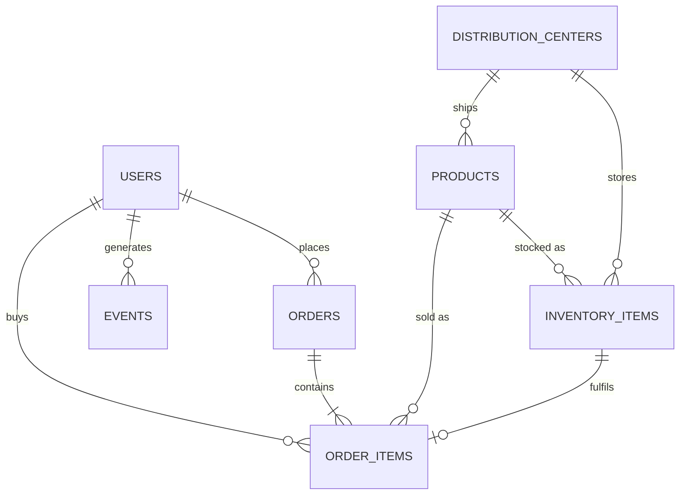

# CyperSoft_Final Project

# TheLook eCommerce – End-to-End Data Analytics Project

> Pipeline ETL → EDA chuyên sâu → Dashboard Power BI trên bộ dữ liệu **TheLook eCommerce** (do Looker team phát triển).

TheLook là một website thương mại điện tử thời trang **giả lập**. Dataset gồm thông tin về khách hàng, sản phẩm, đơn hàng, logistics, web events và các kênh marketing.

---

## Mục lục

1. [Mục tiêu dự án](#1-mục-tiêu-dự-án)
2. [Tổng quan dataset](#2-tổng-quan-dataset)
3. [Mô hình quan hệ dữ liệu (ERD)](#3-mô-hình-quan-hệ-dữ-liệu-erd)
4. [Cấu trúc thư mục](#4-cấu-trúc-thư-mục)
5. [Công nghệ sử dụng](#5-công-nghệ-sử-dụng)
6. [Pipeline ETL](#6-pipeline-etl)
7. [EDA – Phân tích chuyên sâu](#7-eda--phân-tích-chuyên-sâu)
8. [Power BI – Trực quan hóa](#8-power-bi--trực-quan-hóa)
9. [Hướng dẫn chạy dự án](#9-hướng-dẫn-chạy-dự-án)
10. [Hạn chế & hướng phát triển](#10-hạn-chế--hướng-phát-triển)

---

## 1. Mục tiêu dự án

| Nhóm | Câu hỏi kinh doanh chính |
|---|---|
| **Doanh thu & lợi nhuận** | Doanh thu, lợi nhuận gộp, AOV thay đổi thế nào theo thời gian / danh mục / thương hiệu? |
| **Khách hàng** | Ai là khách hàng giá trị nhất? Tỷ lệ quay lại mua? Retention theo cohort? |
| **Sản phẩm** | Danh mục/brand nào sinh lời cao, tỷ lệ trả hàng cao? |
| **Marketing** | Traffic source nào mang lại khách hàng chất lượng nhất? |
| **Hành vi web** | Phễu chuyển đổi từ Home → Product → Cart → Purchase rơi rụng ở đâu? |
| **Logistics** | Thời gian giao hàng, tỷ lệ hủy/trả, trung tâm phân phối nào hiệu quả? |

---

## 2. Tổng quan dataset

Dataset gồm **7 file CSV**:

### 2.1 `distribution_centers.csv`
| Cột | Mô tả |
|---|---|
| `id` | Định danh duy nhất của trung tâm phân phối |
| `name` | Tên trung tâm phân phối |
| `latitude` | Vĩ độ |
| `longitude` | Kinh độ |

### 2.2 `events.csv`
| Cột | Mô tả |
|---|---|
| `id` | Định danh duy nhất của sự kiện |
| `user_id` | Người dùng liên quan đến sự kiện |
| `sequence_number` | Thứ tự sự kiện trong phiên |
| `session_id` | Định danh phiên truy cập |
| `created_at` | Thời điểm xảy ra sự kiện |
| `ip_address` | Địa chỉ IP phát sinh sự kiện |
| `city` | Thành phố |
| `state` | Bang / tỉnh |
| `postal_code` | Mã bưu chính |
| `browser` | Trình duyệt sử dụng |
| `traffic_source` | Nguồn traffic dẫn đến sự kiện |
| `uri` | URI liên quan đến sự kiện |
| `event_type` | Loại sự kiện |

### 2.3 `inventory_items.csv`
| Cột | Mô tả |
|---|---|
| `id` | Định danh mặt hàng tồn kho |
| `product_id` | Sản phẩm liên kết |
| `created_at` | Thời điểm mặt hàng được tạo (nhập kho) |
| `sold_at` | Thời điểm bán |
| `cost` | Giá vốn của mặt hàng |
| `product_category` | Danh mục sản phẩm |
| `product_name` | Tên sản phẩm |
| `product_brand` | Thương hiệu |
| `product_retail_price` | Giá bán lẻ |
| `product_department` | Bộ phận (department) |
| `product_sku` | Mã SKU |
| `product_distribution_center_id` | Trung tâm phân phối liên kết |

### 2.4 `order_items.csv`
| Cột | Mô tả |
|---|---|
| `id` | Định danh order item |
| `order_id` | Đơn hàng liên kết |
| `user_id` | Người đặt hàng |
| `product_id` | Sản phẩm liên kết |
| `inventory_item_id` | Mặt hàng tồn kho liên kết |
| `status` | Trạng thái order item |
| `created_at` | Thời điểm tạo |
| `shipped_at` | Thời điểm gửi hàng |
| `delivered_at` | Thời điểm giao hàng |
| `returned_at` | Thời điểm trả hàng |

### 2.5 `orders.csv`
| Cột | Mô tả |
|---|---|
| `order_id` | Định danh đơn hàng |
| `user_id` | Người đặt hàng |
| `status` | Trạng thái đơn hàng |
| `gender` | Giới tính của người dùng |
| `created_at` | Thời điểm tạo đơn |
| `returned_at` | Thời điểm trả hàng |
| `shipped_at` | Thời điểm gửi hàng |
| `delivered_at` | Thời điểm giao hàng |
| `num_of_item` | Số lượng item trong đơn |

### 2.6 `products.csv`
| Cột | Mô tả |
|---|---|
| `id` | Định danh sản phẩm |
| `cost` | Giá vốn |
| `category` | Danh mục |
| `name` | Tên sản phẩm |
| `brand` | Thương hiệu |
| `retail_price` | Giá bán lẻ |
| `department` | Bộ phận |
| `sku` | Mã SKU |
| `distribution_center_id` | Trung tâm phân phối liên kết |

### 2.7 `users.csv`
| Cột | Mô tả |
|---|---|
| `id` | Định danh người dùng |
| `first_name` | Tên |
| `last_name` | Họ |
| `email` | Email |
| `age` | Tuổi |
| `gender` | Giới tính |
| `state` | Bang / tỉnh |
| `street_address` | Địa chỉ |
| `postal_code` | Mã bưu chính |
| `city` | Thành phố |
| `country` | Quốc gia |
| `latitude` | Vĩ độ |
| `longitude` | Kinh độ |
| `traffic_source` | Nguồn traffic dẫn đến việc đăng ký |
| `created_at` | Thời điểm tạo tài khoản |

> **Lưu ý quan trọng:** `order_items.csv` trong phiên bản này **không có cột `sale_price`**. Doanh thu và giá vốn được lấy qua `inventory_item_id → inventory_items.csv` (`product_retail_price`, `cost`), hoặc qua `product_id → products.csv`.

---

## 3. Mô hình quan hệ dữ liệu (ERD)



| Quan hệ | Khóa nối |
|---|---|
| orders ↔ users | `orders.user_id = users.id` |
| order_items ↔ orders | `order_items.order_id = orders.order_id` |
| order_items ↔ products | `order_items.product_id = products.id` |
| order_items ↔ inventory_items | `order_items.inventory_item_id = inventory_items.id` |
| inventory_items ↔ products | `inventory_items.product_id = products.id` |
| products / inventory_items ↔ distribution_centers | `*.distribution_center_id = distribution_centers.id` |
| events ↔ users | `events.user_id = users.id` (có thể null với khách vãng lai) |

---

## 4. Cấu trúc thư mục

```
thelook-ecommerce-analytics/
├── data/
│   ├── raw/                  # 7 file CSV gốc (không chỉnh sửa)
│   ├── staging/              # Dữ liệu đã làm sạch (parquet/csv)
│   └── warehouse/            # Star schema: dim_*.csv, fact_*.csv (nguồn cho Power BI)
├── etl/
│   ├── extract.py
│   ├── transform.py
│   ├── load.py
│   ├── quality_checks.py
│   └── run_pipeline.py
├── notebooks/
│   ├── 01_data_profiling.ipynb
│   ├── 02_eda_sales.ipynb
│   ├── 03_eda_customers_rfm_cohort.ipynb
│   ├── 04_eda_funnel_marketing.ipynb
│   └── 05_eda_logistics_returns.ipynb
├── powerbi/
│   ├── TheLook_Dashboard.pbix
│   └── dax_measures.md
├── reports/
│   └── figures/
├── requirements.txt
└── README.md
```

---

## 5. Công nghệ sử dụng

| Lớp | Công cụ |
|---|---|
| Ngôn ngữ | Python 3.10+ |
| ETL | pandas, numpy, pyarrow |
| Kiểm tra chất lượng | pandas + assert (hoặc Great Expectations) |
| EDA | pandas, matplotlib, seaborn, plotly, scipy |
| Lưu trữ | Parquet / CSV (hoặc SQL database) |
| Visualization | Power BI Desktop (DAX, Power Query) |

---

## 6. Pipeline ETL

```
 raw CSV ──► EXTRACT ──► TRANSFORM ──► QUALITY CHECK ──► LOAD (Star Schema) ──► Power BI
```

### Bước 1 – Extract

Đọc 7 file CSV, ép kiểu ngay từ đầu để tránh sai lệch.

```python
# etl/extract.py
import pandas as pd
from pathlib import Path

RAW = Path("data/raw")

DATE_COLS = {
    "events": ["created_at"],
    "inventory_items": ["created_at", "sold_at"],
    "order_items": ["created_at", "shipped_at", "delivered_at", "returned_at"],
    "orders": ["created_at", "shipped_at", "delivered_at", "returned_at"],
    "users": ["created_at"],
    "products": [],
    "distribution_centers": [],
}

def extract() -> dict[str, pd.DataFrame]:
    tables = {}
    for name, dates in DATE_COLS.items():
        tables[name] = pd.read_csv(RAW / f"{name}.csv", parse_dates=dates)
    return tables
```

### Bước 2 – Profiling & Kiểm tra chất lượng dữ liệu (trước khi transform)

| Kiểm tra | Cách làm |
|---|---|
| Trùng khóa chính | `df["id"].is_unique` |
| Giá trị null | `df.isna().mean()` theo từng cột |
| Toàn vẹn tham chiếu (FK) | Kiểm tra `order_items.user_id` ∈ `users.id`, … |
| Logic thời gian | `created_at ≤ shipped_at ≤ delivered_at ≤ returned_at` |
| Giá trị bất thường | `age` ngoài khoảng hợp lý, `cost > retail_price`, giá âm |

```python
# etl/quality_checks.py
def run_checks(t):
    assert t["users"]["id"].is_unique, "users.id bị trùng"
    assert t["products"]["id"].is_unique, "products.id bị trùng"

    # FK check
    orphan = ~t["order_items"]["user_id"].isin(t["users"]["id"])
    print(f"order_items mồ côi user: {orphan.sum()}")

    # Logic thời gian
    oi = t["order_items"]
    bad_ship = (oi["shipped_at"] < oi["created_at"]).sum()
    bad_deliv = (oi["delivered_at"] < oi["shipped_at"]).sum()
    print(f"shipped < created: {bad_ship} | delivered < shipped: {bad_deliv}")

    # Cost vs price
    p = t["products"]
    print(f"cost > retail_price: {(p['cost'] > p['retail_price']).sum()}")
```

### Bước 3 – Transform

**3.1 Làm sạch**
- Chuẩn hóa text: `strip()`, `lower()` cho `email`, `city`, `state`, `browser`, `traffic_source`.
- Xóa bản ghi trùng, xử lý null (giữ null có ý nghĩa như `returned_at`, `shipped_at`).
- Loại hoặc gắn cờ bản ghi vi phạm logic thời gian.
- Gắn cờ `user_id` null trong `events` là **khách vãng lai (anonymous)**.

**3.2 Làm giàu (feature engineering)**

| Feature | Công thức | Bảng |
|---|---|---|
| `retail_price`, `cost` (cấp item) | join `inventory_items` qua `inventory_item_id` | fact_order_items |
| `gross_profit` | `retail_price - cost` | fact_order_items |
| `is_returned` | `returned_at.notna()` | fact_order_items |
| `is_cancelled` | `status == 'Cancelled'` | fact_order_items |
| `days_to_ship` | `shipped_at - created_at` (ngày) | fact_order_items |
| `days_to_deliver` | `delivered_at - shipped_at` (ngày) | fact_order_items |
| `days_in_stock` | `sold_at - inventory.created_at` | fact_inventory |
| `age_group` | cắt nhóm tuổi (<18, 18–24, 25–34, 35–44, 45–54, 55+) | dim_user |
| `margin_pct` | `gross_profit / retail_price` | fact_order_items |
| `order_month`, `order_quarter`, `order_year` | từ `created_at` | dim_date |
| `distance_km` | Haversine giữa user và distribution center | fact_order_items |

```python
# etl/transform.py
import numpy as np
import pandas as pd

def build_fact_order_items(t):
    oi = t["order_items"].merge(
        t["inventory_items"][["id", "cost", "product_retail_price",
                              "product_distribution_center_id"]],
        left_on="inventory_item_id", right_on="id", suffixes=("", "_inv"),
    ).drop(columns="id_inv")

    oi = oi.rename(columns={"product_retail_price": "retail_price"})
    oi["gross_profit"]    = oi["retail_price"] - oi["cost"]
    oi["is_returned"]     = oi["returned_at"].notna()
    oi["is_cancelled"]    = oi["status"].str.lower().eq("cancelled")
    oi["days_to_ship"]    = (oi["shipped_at"] - oi["created_at"]).dt.total_seconds() / 86400
    oi["days_to_deliver"] = (oi["delivered_at"] - oi["shipped_at"]).dt.total_seconds() / 86400
    oi["order_date_key"]  = oi["created_at"].dt.strftime("%Y%m%d").astype(int)
    return oi

def build_dim_user(users):
    bins = [0, 17, 24, 34, 44, 54, 120]
    labels = ["<18", "18-24", "25-34", "35-44", "45-54", "55+"]
    users = users.copy()
    users["age_group"] = pd.cut(users["age"], bins=bins, labels=labels)
    users["full_name"] = users["first_name"].str.strip() + " " + users["last_name"].str.strip()
    return users.drop(columns=["first_name", "last_name", "street_address"])  # giảm PII

def build_dim_date(start, end):
    d = pd.DataFrame({"date": pd.date_range(start, end)})
    d["date_key"] = d["date"].dt.strftime("%Y%m%d").astype(int)
    d["year"] = d["date"].dt.year
    d["quarter"] = d["date"].dt.quarter
    d["month"] = d["date"].dt.month
    d["month_name"] = d["date"].dt.strftime("%b")
    d["week"] = d["date"].dt.isocalendar().week
    d["day_of_week"] = d["date"].dt.day_name()
    d["is_weekend"] = d["date"].dt.dayofweek >= 5
    return d
```

**3.3 Xử lý bảng `events` (dung lượng lớn)**
- Tạo `fact_sessions`: gom theo `session_id` → số event, có `cart` không, có `purchase` không, thời lượng phiên.
- Tạo cờ funnel theo từng phiên: `has_product`, `has_cart`, `has_purchase`.

### Bước 4 – Load (Star Schema)

```
                    dim_date
                       │
 dim_user ─── fact_order_items ─── dim_product ─── dim_distribution_center
                       │
                  dim_order (status, num_of_item, gender)

 dim_user ─── fact_sessions (từ events) ─── dim_date
 dim_product ─── fact_inventory (từ inventory_items) ─── dim_distribution_center
```

| Bảng | Grain (mỗi dòng là…) |
|---|---|
| `fact_order_items` | 1 order item |
| `fact_sessions` | 1 session web |
| `fact_inventory` | 1 inventory item |
| `dim_user` | 1 người dùng |
| `dim_product` | 1 sản phẩm |
| `dim_distribution_center` | 1 trung tâm phân phối |
| `dim_order` | 1 đơn hàng |
| `dim_date` | 1 ngày |

```python
# etl/load.py
from pathlib import Path

OUT = Path("data/warehouse")

def load(tables: dict):
    OUT.mkdir(parents=True, exist_ok=True)
    for name, df in tables.items():
        df.to_parquet(OUT / f"{name}.parquet", index=False)   # hoặc to_csv cho Power BI
```

### Bước 5 – Orchestration

```python
# etl/run_pipeline.py
from extract import extract
from quality_checks import run_checks
from transform import build_fact_order_items, build_dim_user, build_dim_date
from load import load

def main():
    t = extract()
    run_checks(t)
    warehouse = {
        "fact_order_items": build_fact_order_items(t),
        "dim_user": build_dim_user(t["users"]),
        "dim_product": t["products"],
        "dim_distribution_center": t["distribution_centers"],
        "dim_order": t["orders"],
        "dim_date": build_dim_date("2019-01-01", "2026-12-31"),
    }
    load(warehouse)

if __name__ == "__main__":
    main()
```

---

## 7. EDA – Phân tích chuyên sâu

### 7.1 Data profiling
- Kích thước từng bảng, kiểu dữ liệu, tỷ lệ null, phân phối giá trị.
- Phân phối `age`, `retail_price`, `cost`, `num_of_item` (histogram, boxplot, phát hiện outlier bằng IQR).

### 7.2 Doanh thu & lợi nhuận

| Phân tích | Chỉ số / Biểu đồ |
|---|---|
| Xu hướng theo thời gian | Revenue, Gross Profit, số đơn theo tháng/quý; YoY, MoM |
| Tính mùa vụ | Heatmap tháng × ngày trong tuần |
| Danh mục & thương hiệu | Top/bottom theo revenue, margin %; **Pareto 80/20** |
| Department | So sánh Men vs Women |
| AOV | `Revenue / số đơn`, phân phối AOV |
| Cơ cấu giá | Retail price vs cost, margin theo category |

### 7.3 Phân tích khách hàng

| Phân tích | Mô tả |
|---|---|
| **Nhân khẩu học** | Tuổi, giới tính, bang/thành phố; doanh thu/khách theo nhóm |
| **RFM** | Recency, Frequency, Monetary → chấm điểm 1–5 → phân khúc (Champions, Loyal, At Risk, Lost…) |
| **Cohort retention** | Nhóm khách theo tháng đăng ký, theo dõi tỷ lệ mua lại M0…M12 |
| **Repeat purchase rate** | % khách mua ≥ 2 đơn; thời gian giữa 2 lần mua |
| **CLV (đơn giản)** | `AOV × tần suất × tuổi thọ` hoặc tổng lợi nhuận gộp lũy kế |
| **Khách mới vs quay lại** | Tỷ trọng doanh thu theo tháng |

```python
# Ví dụ RFM
import pandas as pd

snapshot = fact["created_at"].max() + pd.Timedelta(days=1)
rfm = (fact.groupby("user_id")
           .agg(recency=("created_at", lambda s: (snapshot - s.max()).days),
                frequency=("order_id", "nunique"),
                monetary=("retail_price", "sum")))

rfm["R"] = pd.qcut(rfm["recency"], 5, labels=[5, 4, 3, 2, 1]).astype(int)
rfm["F"] = pd.qcut(rfm["frequency"].rank(method="first"), 5, labels=[1, 2, 3, 4, 5]).astype(int)
rfm["M"] = pd.qcut(rfm["monetary"], 5, labels=[1, 2, 3, 4, 5]).astype(int)
rfm["RFM_score"] = rfm["R"].astype(str) + rfm["F"].astype(str) + rfm["M"].astype(str)
```

```python
# Ví dụ cohort retention
fact["order_month"]  = fact["created_at"].dt.to_period("M")
first = fact.groupby("user_id")["order_month"].min().rename("cohort_month")
df = fact.join(first, on="user_id")
df["period"] = (df["order_month"] - df["cohort_month"]).apply(lambda x: x.n)

cohort = (df.groupby(["cohort_month", "period"])["user_id"].nunique()
            .unstack(fill_value=0))
retention = cohort.div(cohort[0], axis=0)
```

### 7.4 Marketing & Traffic source
- So sánh `users.traffic_source` về: số user, tỷ lệ chuyển đổi sang mua hàng, AOV, CLV, retention.
- So sánh `events.traffic_source` ở cấp phiên: số phiên, conversion rate.
- Kiểm định thống kê (chi-square / ANOVA / Kruskal-Wallis) xem khác biệt giữa các nguồn có ý nghĩa không.

### 7.5 Hành vi web – Funnel

```
Home → Department → Product → Cart → Purchase
```

- Đếm số **session** đi qua từng bước, tính tỷ lệ chuyển đổi và drop-off.
- Phân tích theo `browser`, `traffic_source`, `state`.
- Phân tích độ dài phiên, số event/phiên, hành vi bỏ giỏ hàng (cart abandonment).

### 7.6 Sản phẩm & tồn kho
- Số ngày tồn kho trung bình (`sold_at − created_at`), tỷ lệ bán hết theo category.
- Hàng chậm luân chuyển (slow movers) và hàng tồn chưa bán (`sold_at` null).
- Tỷ lệ trả hàng theo category / brand → tìm sản phẩm có vấn đề.

### 7.7 Logistics & Trả hàng

| Chỉ số | Cách tính |
|---|---|
| Thời gian xử lý | `shipped_at − created_at` |
| Thời gian giao | `delivered_at − shipped_at` |
| Tổng lead time | `delivered_at − created_at` |
| Return rate | `đơn trả / đơn đã giao` |
| Cancel rate | `đơn hủy / tổng đơn` |
| Hiệu quả DC | Lead time, return rate, số đơn theo từng distribution center |
| Khoảng cách | Haversine giữa DC và khách ↔ lead time |

### 7.8 Kết quả (điền sau khi chạy)

| # | Insight | Tác động kinh doanh | Đề xuất |
|---|---|---|---|
| 1 | … | … | … |
| 2 | … | … | … |
| 3 | … | … | … |

---

## 8. Power BI – Trực quan hóa

### 8.1 Kết nối dữ liệu
1. **Get Data → Folder / Parquet / CSV** → chọn thư mục `data/warehouse/`.
2. Trong **Power Query**: kiểm tra kiểu dữ liệu, đổi tên cột, tắt load các bảng trung gian.
3. Với `fact_sessions` lớn → ưu tiên import đã tổng hợp thay vì raw events.

### 8.2 Data model (Star Schema)

| Từ (Many) | Đến (One) | Cardinality |
|---|---|---|
| `fact_order_items[order_date_key]` | `dim_date[date_key]` | * → 1 |
| `fact_order_items[user_id]` | `dim_user[id]` | * → 1 |
| `fact_order_items[product_id]` | `dim_product[id]` | * → 1 |
| `fact_order_items[order_id]` | `dim_order[order_id]` | * → 1 |
| `dim_product[distribution_center_id]` | `dim_distribution_center[id]` | * → 1 |
| `fact_sessions[user_id]` | `dim_user[id]` | * → 1 |

- Filter direction: **Single** (từ dim → fact).
- Đánh dấu `dim_date` là **Date table**.

### 8.3 DAX Measures

```dax
-- Cốt lõi
Revenue        = SUM ( fact_order_items[retail_price] )
Total Cost     = SUM ( fact_order_items[cost] )
Gross Profit   = [Revenue] - [Total Cost]
Gross Margin % = DIVIDE ( [Gross Profit], [Revenue] )
Orders         = DISTINCTCOUNT ( fact_order_items[order_id] )
Customers      = DISTINCTCOUNT ( fact_order_items[user_id] )
Items Sold     = COUNTROWS ( fact_order_items )
AOV            = DIVIDE ( [Revenue], [Orders] )

-- So sánh thời gian
Revenue LY     = CALCULATE ( [Revenue], SAMEPERIODLASTYEAR ( dim_date[date] ) )
Revenue YoY %  = DIVIDE ( [Revenue] - [Revenue LY], [Revenue LY] )
Revenue MoM %  =
VAR _prev = CALCULATE ( [Revenue], DATEADD ( dim_date[date], -1, MONTH ) )
RETURN DIVIDE ( [Revenue] - _prev, _prev )
Revenue YTD    = TOTALYTD ( [Revenue], dim_date[date] )

-- Trả hàng / hủy
Return Rate %  =
DIVIDE (
    CALCULATE ( COUNTROWS ( fact_order_items ), fact_order_items[is_returned] = TRUE () ),
    COUNTROWS ( fact_order_items )
)
Cancel Rate %  =
DIVIDE (
    CALCULATE ( COUNTROWS ( fact_order_items ), fact_order_items[is_cancelled] = TRUE () ),
    COUNTROWS ( fact_order_items )
)

-- Logistics
Avg Days to Ship    = AVERAGE ( fact_order_items[days_to_ship] )
Avg Days to Deliver = AVERAGE ( fact_order_items[days_to_deliver] )

-- Khách hàng
New Customers =
VAR _first =
    ADDCOLUMNS (
        VALUES ( dim_user[id] ),
        "@first", CALCULATE ( MIN ( fact_order_items[created_at] ), ALL ( dim_date ) )
    )
RETURN
    COUNTROWS (
        FILTER ( _first, [@first] >= MIN ( dim_date[date] ) && [@first] <= MAX ( dim_date[date] ) )
    )

Repeat Customer % =
VAR _multi =
    COUNTROWS (
        FILTER ( VALUES ( dim_user[id] ), CALCULATE ( [Orders] ) >= 2 )
    )
RETURN DIVIDE ( _multi, [Customers] )

-- Funnel (từ fact_sessions)
Sessions          = COUNTROWS ( fact_sessions )
Cart Rate %       = DIVIDE ( CALCULATE ( [Sessions], fact_sessions[has_cart] = TRUE () ), [Sessions] )
Conversion Rate % = DIVIDE ( CALCULATE ( [Sessions], fact_sessions[has_purchase] = TRUE () ), [Sessions] )
```

### 8.4 Cấu trúc Dashboard

| Trang | Nội dung | Visual chính |
|---|---|---|
| **1. Executive Overview** | KPI tổng quan | Card (Revenue, Profit, Orders, AOV, Margin %), line chart xu hướng, YoY, slicer năm/quý |
| **2. Product & Category** | Hiệu quả sản phẩm | Bar top category/brand, Pareto, treemap, scatter (revenue vs margin), return rate theo category |
| **3. Customer Analytics** | Chân dung & giá trị khách | Cột nhóm tuổi/giới tính, bản đồ theo bang, phân khúc RFM, ma trận cohort retention |
| **4. Marketing & Funnel** | Nguồn traffic & chuyển đổi | Funnel chart, bảng traffic source (users, CR, AOV, CLV), drop-off theo browser |
| **5. Logistics & Returns** | Vận hành | Map distribution center + đơn hàng, lead time, return/cancel rate, status breakdown |
| **6. Drill-through** | Chi tiết khách / sản phẩm | Trang drill-through theo `dim_user` và `dim_product` |

### 8.5 Thực hành tốt khi thiết kế
- Một bảng màu nhất quán, tối đa 5–6 màu; dùng màu nhấn cho chỉ số cảnh báo (return rate, cancel rate).
- KPI card ở trên cùng, chi tiết ở dưới; không nhồi quá 6–8 visual/trang.
- Dùng **bookmark + tooltip trang** cho thông tin phụ, **Sync slicers** giữa các trang.
- Đặt tên measure rõ ràng, gom vào bảng `_Measures` riêng.
- Bật **Row-level security** nếu cần phân quyền theo khu vực (bang).

---

## 9. Hướng dẫn chạy dự án

```bash
# 1. Clone repo
git clone <repo-url> && cd thelook-ecommerce-analytics

# 2. Tạo môi trường
python -m venv .venv
source .venv/bin/activate        # Windows: .venv\Scripts\activate
pip install -r requirements.txt

# 3. Đặt 7 file CSV vào data/raw/

# 4. Chạy pipeline ETL
python etl/run_pipeline.py

# 5. Chạy EDA
jupyter lab notebooks/

# 6. Mở powerbi/TheLook_Dashboard.pbix → Refresh (trỏ lại đường dẫn data/warehouse/)
```

**`requirements.txt` gợi ý**

```
pandas>=2.0
numpy
pyarrow
matplotlib
seaborn
plotly
scipy
jupyterlab
```

---

## 10. Hạn chế & hướng phát triển

**Hạn chế**
- Dữ liệu **giả lập** → insight mang tính minh họa, không phản ánh thị trường thực.
- Không có cột `sale_price` trong `order_items` → doanh thu quy ước theo giá bán lẻ niêm yết (chưa tính giảm giá).
- Không có dữ liệu chi phí marketing → không tính được CAC, ROAS.

**Hướng phát triển**
- Dự báo doanh thu (Prophet / SARIMA), dự đoán churn, gợi ý sản phẩm.
- Đưa pipeline lên Airflow / Prefect, lưu warehouse trên BigQuery / PostgreSQL.
- Tự động refresh Power BI qua Gateway / Power BI Service.
- A/B test giả lập cho tối ưu funnel.

---

## Nguồn dữ liệu

TheLook eCommerce — do Looker team phát triển (dataset công khai, dữ liệu giả lập).